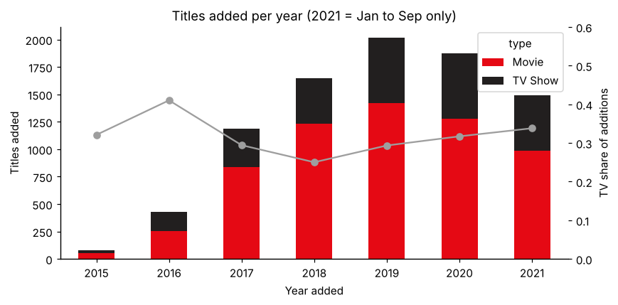
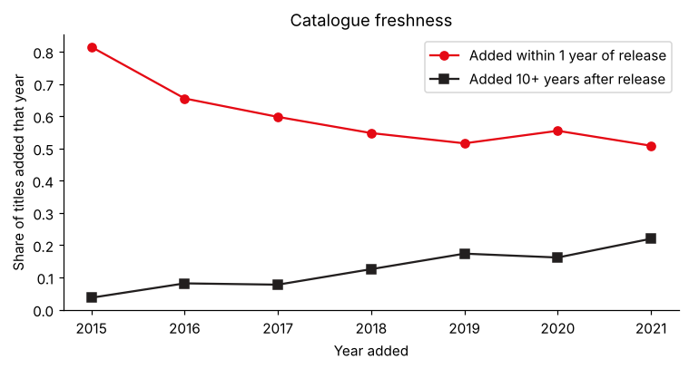
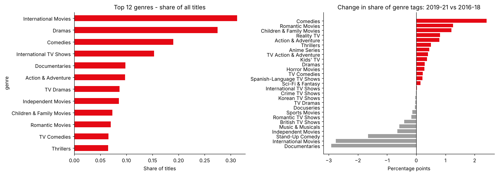
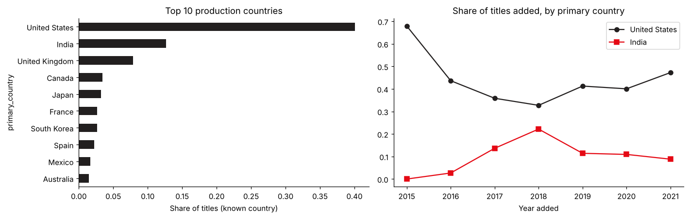

# Netflix Content Strategy Analytics

An end-to-end analytics pipeline on the Netflix catalogue: a **PySpark ETL** with explicit grain checks, a **SQL layer** (MySQL schema plus portable KPI queries, validated against pandas), and an interactive **Streamlit + Plotly dashboard**. It answers five content-strategy questions: growth, freshness, genres, geography and audience.

    

## Key findings (catalogue snapshot up to 25 Sept 2021: 8,807 titles)

| Question | Finding |
|---|---|
| **Growth** | Additions peaked at 2,014 titles in 2019. The TV share of additions has risen from 25% (2018) to 34% (2021). |
| **Freshness** | Titles added within a year of release fell from 82% (2015) to 51% (2021). Titles added 10+ years after release rose from 4% to 22%: growth increasingly relies on back-catalogue licensing. |
| **Genres** | 2019–21 vs 2016–18: Comedies (+2.4 pts), Romantic (+1.3) and Family (+1.2) gained share; Documentaries (−2.9), International Movies (−2.8) and Stand-Up (−1.7) lost share. |
| **Geography** | US (40%) and India (13%) make up 53% of titles with a known country. India's share of additions peaked at 22% in 2018 and fell back to 9% by 2021. |
| **Audience** | Adult-skewed: TV-MA is 36% of the catalogue. TV has a larger kids-and-family share than movies (30% vs 21%). |

**Data engineering findings**

- **Snapshot anchoring.** Measuring content age against the catalogue snapshot gives a "recent" (≤ 5 years) share of **64.2%**. Measuring against today's date, as the original course pipeline did, gives **6.7%** in 2026, and the figure falls further every year. Freshness KPIs built on a runtime clock silently drift.
- **Grain.** The source has 2.19 rows per title (one per genre tag). A naive `COUNT(*)` after joining genres more than doubles every title KPI, so the pipeline outputs two tables with explicit grain and validates them.
- **Source defects.** 22 titles have values shifted into the rating column (cast names, years, durations). They are repaired or flagged, not silently kept.

<p align="center">
   <br>
  <br>
  
</p>

## Architecture

```
data/clean_netflix.csv ──► notebooks/01_spark_etl.ipynb (PySpark)
   (title × genre rows)        │  audit · repair · snapshot-anchored features · grain checks
                               ▼
                 data/processed/titles.csv        (1 row per title)
                 data/processed/title_genres.csv  (1 row per title × genre)
                 data/processed/kpis.json
                     │                    │                          │
                     ▼                    ▼                          ▼
 notebooks/02_content_strategy   sql/mysql_load.sql (MySQL)    app/app.py (Streamlit)
 _analysis.ipynb (pandas +       sql/kpi_queries.sql           reads CSVs by default,
 SQL cross-check on SQLite)      (portable KPIs)               or MySQL via env vars
```

## How to run

```bash
git clone https://github.com/kashiprasadtn/netflix-content-strategy-analytics.git
cd netflix-content-strategy-analytics
python -m venv .venv && source .venv/bin/activate   # Windows: .venv\Scripts\activate
pip install -r requirements.txt

# 1. Dashboard only (processed data is already in the repo)
streamlit run app/app.py

# 2. Re-run the pipeline (needs Java 17+ for PySpark)
jupyter lab notebooks/01_spark_etl.ipynb               # regenerates data/processed/
jupyter lab notebooks/02_content_strategy_analysis.ipynb

# 3. Optional: serve the dashboard from MySQL
mysql --local-infile=1 -u <user> -p < sql/mysql_load.sql
export NETFLIX_SOURCE=mysql MYSQL_HOST=127.0.0.1 MYSQL_USER=<user> MYSQL_PASSWORD=<password> MYSQL_DATABASE=netflix_db
streamlit run app/app.py
```

**Start from the raw Kaggle file (optional).** Download `netflix_titles.csv` from Kaggle and save it as `data/raw/netflix_titles.csv`. `01_spark_etl.ipynb` detects it and performs the first-stage cleaning itself.

## Dashboard

- **Sidebar filters:** content type, release-year range, country (top 25) and audience.
- **KPI row:** titles, movie/TV split, recent share, share added within a year of release, number of countries.
- **Tabs:** Portfolio (additions by year, titles by release year) · Freshness (age groups, addition lag) · Genres (top 15, trends of the top 6) · Geography & audience.
- Title-level metrics use one row per title, and genre metrics use the title × genre table, so nothing is double counted.

## Repository structure

```
netflix-content-strategy-analytics/
├── data/
│   ├── clean_netflix.csv            # pipeline input (first-stage cleaned, title × genre)
│   ├── raw/                         # optional: place netflix_titles.csv here
│   └── processed/                   # ETL outputs used by the analysis, SQL and dashboard
├── notebooks/
│   ├── 01_spark_etl.ipynb
│   └── 02_content_strategy_analysis.ipynb
├── sql/
│   ├── mysql_load.sql               # MySQL schema + LOAD DATA
│   └── kpi_queries.sql              # portable KPI queries (validated in notebook 02)
├── app/app.py                       # Streamlit dashboard
├── outputs/figures/   outputs/metrics/
├── reports/Netflix_Content_Strategy_Report.docx
├── requirements.txt   LICENSE   README.md
```

## Limitations

- A public catalogue snapshot (to September 2021). There is no viewing, revenue or regional-availability data, so the analysis describes what Netflix *added*, not what members *watched*.
- Removed titles are not in the data, and 2021 covers only nine months.
- `primary_country` uses the first listed country, so co-productions are attributed to one country.

## Data and attribution

- **Dataset:** *Netflix Movies and TV Shows* (Shivam Bansal, Kaggle), first-stage cleaned in upGrad coursework (`clean_netflix.csv`). See the Kaggle page for licence terms. Netflix is a trademark of Netflix, Inc.; this is an independent educational analysis.
- The pipeline, SQL, dashboard and analysis in this repository are my own implementation. They extend an upGrad content-strategy exercise; its solution files are not reproduced here.
- Completed as part of the MS in Artificial Intelligence (Liverpool John Moores University, delivered via upGrad).

## Licence

Code is released under the [MIT License](LICENSE). The dataset is excluded.
